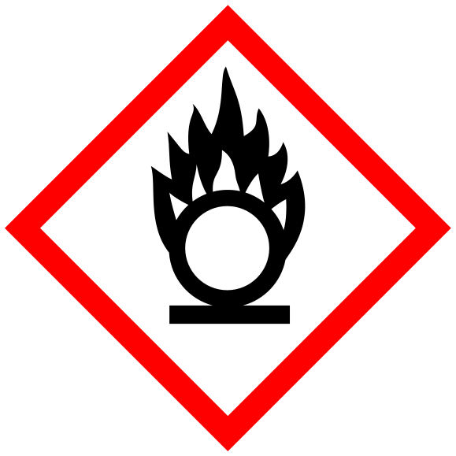

<div align="center">
 

# Cargo-Coverage-Gate

[](https://crates.io/crates/cargo-coverage-gate)
[](https://docs.rs/cargo-coverage-gate)
[](https://crates.io/crates/cargo-coverage-gate)
[](https://github.com/microsoft/ox-tools/actions/workflows/anvil-scheduled.yml)
[](https://codecov.io/gh/microsoft/ox-tools)
[](../../LICENSE)
<a href="../.."></a>

</div>

## cargo-coverage-gate

A pull-request-time gate that compares per-package line coverage produced
by [`cargo-llvm-cov`][__link0] against per-package thresholds carried in
`Cargo.toml`. The accompanying `cargo-coverage-gate` binary can either read
existing LCOV tracefiles or collect them through a portable
cargo-llvm-cov and
nextest. It resolves each package’s base policy from a small three-layer
lookup, applies any matching package target policy, and emits a verdict
table to stdout (and,
optionally, to a Markdown summary file for CI step summaries). A failing
verdict includes actionable details without relying on a later
coverage-service upload. A coverable line is a distinct LCOV `DA:` record.
Before aggregation, the CLI and released-surface library APIs filter each
tracefile using provable Cargo source and test-only boundaries.
Test, example, bench, build-script, and other non-release target sources
are removed when their non-release ownership is established. Within a
released source file, only items whose `cfg`
semantics require `test` (plus ordinary `#[test]`/`#[bench]` functions) are
removed; feature-gated `test-util` APIs remain measured when they can compile
in a non-test build. Local Cargo target `required-features` are treated as
enabled at the target root, so code that requires one of those features to
be absent is not part of that target’s released surface. Dependency
selectors such as `dep/feature`, `dep?/feature`, and `dep:dep` do not create
local `cfg(feature = ...)` atoms. Dependency-feature availability does not
prove local-feature activation, even for optional or renamed dependencies
exposing a same-named local feature: another feature may activate the
dependency through `dep:dep`.

A potentially released source-declaring macro or a measured file missing
from the module graph makes indirect source ownership uncertain.
Filtering then warns on stderr, removes only file-local
test-only ranges, and retains ambiguous counters, including zero-hit
production lines. Such output is conservative, not complete production-only
classification. Ordinary authored `#[cfg(test)]` blocks still need no
annotations. Exceptional helpers can use the existing nightly
`#[cfg_attr(coverage_nightly, coverage(off))]` attribute when appropriate;
enable `#![cfg_attr(coverage_nightly, feature(coverage_attribute))]` in the
containing crate. This does not expand macros, classify generated tests,
or recover sources omitted from the input LCOV.
A measured, readable Rust file in a known workspace member namespace
retains its counters even when its declaring module is inside an opaque
macro. The filter parses its local syntax without expanding that macro.

Compiler-library records that escape upstream filename exclusions are
removed only after canonical source paths establish that they are beneath
the library-source tree reported by the selected `RUSTC --print sysroot`.
Cargo-owned project sources take precedence, including explicit sources
outside their package directory. Unknown project or dependency sources
still fail; directory names alone never establish compiler ownership.
Numeric failures show exact covered/coverable counts and uncovered ranges;
`expect-no-coverable-lines` failures show the unexpected coverable ranges;
and `NO DATA` explains that no records were attributed. Location lists are
bounded, with an exact count of omitted locations.

### 0.7 migration

Version 0.7 intentionally changes [`evaluate`][__link1], [`evaluate_many`][__link2], and
[`evaluate_many_for_target`][__link3] to evaluate the released Cargo surface rather
than every attributed LCOV line. Existing callers that deliberately include
tests or other non-release targets should migrate to the corresponding
`evaluate_unfiltered*` function. The released-surface APIs also treat each
target’s local Cargo `required-features` as enabled when classifying its
source. Dependency-qualified requirements do not imply local cfg features.

### Configuration

#### Numeric thresholds

A workspace can define the default line-coverage threshold:

```toml
# Illustrative workspace policy.
[workspace.metadata.coverage-gate]
min-lines-percent = 80
```

Individual packages can override it:

```toml
# Illustrative package policy, intentionally stricter than the workspace.
[package.metadata.coverage-gate]
min-lines-percent = 95
```

For each workspace member, the base threshold is the first match
among:

1. `[package.metadata.coverage-gate] min-lines-percent = N` in the package’s
   `Cargo.toml`,
1. `[workspace.metadata.coverage-gate] min-lines-percent = N` in the workspace
   root `Cargo.toml`, or
1. The built-in default of `100.0` — full coverage required.

Setting `min-lines-percent = 0.0` explicitly opts a package out of
gating: it always passes, regardless of attributed data. Thresholds must
be in the inclusive range `0.0..=100.0`.

#### Packages with no coverable lines

A package that legitimately contains no coverable lines (pure re-exports,
type definitions, or a thin binary shim) can make that invariant explicit:

```toml
[package.metadata.coverage-gate]
expect-no-coverable-lines = true
```

The gate passes only while the package has no attributed coverable lines
and fails as a regression if coverable code later appears. This differs
from `min-lines-percent = 0`, which keeps passing if the package grows
coverable code. The two keys are mutually exclusive, and
`expect-no-coverable-lines` is package-scoped only.

#### Qualified test attributes

Compiler-owned `#[test]` and `#[bench]` attributes are recognized
intrinsically. Qualified framework attributes are exact workspace policy,
never inferred from a final `test`/`bench` path segment:

```toml
[workspace.metadata.coverage-gate]
test-attributes = ["my_runtime::test"]
```

The list has no qualified defaults and cannot be set per package. Paths
are accepted if valid in any supported Rust edition, so mixed-edition
workspaces can list older attribute names without raw-identifier spelling.

#### Target-specific policies

A package can replace its base policy for a Cargo-style target selector:

```toml
[package.metadata.coverage-gate]
min-lines-percent = 100

[package.metadata.coverage-gate.target.'cfg(not(windows))']
expect-no-coverable-lines = true

[package.metadata.coverage-gate.target.x86_64-unknown-linux-gnu]
min-lines-percent = 100
```

A target-specific no-coverable-lines assertion uses the same nesting:

```toml
[package.metadata.coverage-gate.target.thumbv7em-none-eabihf]
expect-no-coverable-lines = true
```

Target tables are package-scoped; they are invalid in workspace metadata.
Their keys accept exact Rust target triples or quoted `cfg(...)` expressions
using the target-derived subset of Cargo’s target grammar. Target
configuration options such as `windows`, `unix`, `target_os`, and
`target_arch` are supported. Build-context options such as `feature`, `test`,
`debug_assertions`, and `proc_macro` are rejected because a standalone target
query cannot evaluate them. A selected target table sets either
`min-lines-percent` or `expect-no-coverable-lines = true`, completely
replacing the package’s base policy to produce its effective policy. Exact
triples take precedence over matching `cfg(...)` expressions. Multiple
matching cfg policies are a configuration error rather than depending on
declaration order.

A zero target-specific threshold disables gating on the matching target,
but does not disable test execution or instrumentation. Those test binaries
remain instrumented because they may contribute coverage to other packages.
When cargo-llvm-cov discovers only objects with no coverage maps, `run`
writes and evaluates an empty lcov tracefile: zero-threshold and
`expect-no-coverable-lines` packages pass, while positively gated packages
report `NO DATA`.

### Why lcov, not the JSON?

`cargo-llvm-cov` exports the same instrumentation run in several
formats (JSON, lcov, cobertura, codecov-custom-JSON). The gate
consumes lcov because that is what every other coverage report fed by
the same data sees: Codecov and ADO ingest lcov uploads directly, and the
lcov line semantics (“a line is covered if any region on it was
hit”) match the human reading of “did we hit this line”. The JSON
export uses a stricter “every region on the line must be hit”
interpretation that systematically reports a couple of
percentage-points lower, which makes calibrating thresholds against
Codecov / ADO numbers confusing.

### Binary usage

```text
cargo coverage-gate [EVALUATION OPTIONS]
cargo coverage-gate run [SELECTION] [COLLECTION OPTIONS] [--summary-file <PATH>] [--quiet]
```

The bare command retains its existing CLI shape while filtering existing
LCOV files to the released surface before evaluation.
`cargo coverage-gate run` collects `all-features` and
`no-default-features` coverage with cargo-llvm-cov plus nextest by default,
writes released-surface-filtered `lcov-all-features.info` and
`lcov-no-default.info` under `target/coverage`, and evaluates those exact
files in-process. CI integrations can upload those same artifacts to
Codecov or Azure DevOps. Collection can
be limited with repeatable `--package` selectors; no selectors means the
workspace. Use repeatable `--configuration`, `--coverage-dir`, and `--jobs`
options to customize collection.

Instrumented collection requires the invoking Cargo and rustc to be nightly
and cargo-llvm-cov 0.9.0 or newer. The command honors inherited `CARGO`,
`RUSTC`, `RUSTUP_TOOLCHAIN`, and `PATH` rather than selecting a toolchain
itself. Every selected package is instrumented regardless of its coverage
policy. Callers may repeat `--no-coverage-target <TRIPLE>` to explicitly run
plain nextest without LCOV or gating on listed targets. `run` resolves one
effective target from explicit `--target` or the rustc host, then passes it
explicitly to test execution, reporting, and evaluation. This deliberately
overrides `CARGO_BUILD_TARGET` and Cargo `build.target` configuration.
`--quiet` suppresses all collection and verdict stdout while preserving
stderr diagnostics and summary output.

Every feature configuration uses a fresh target beneath private
per-invocation scratch, so collection never runs workspace-wide
`cargo llvm-cov clean` or deletes shared report and test artifacts. Ordinary
Cargo and cargo-llvm-cov target variables point at that same private
configuration directory, including metadata-derived test paths. Raw reports
are written inside that scratch space, released-surface filtered, staged
beside their stable `--coverage-dir` paths, and atomically published only
after filtering succeeds. On Windows error 206, the report child uses
deterministic Windows quoting and retries the validated `llvm-cov export`
arguments through a response file in the same scratch space before entering
that publication pipeline. Concurrent collection must use distinct coverage
directories; private profile isolation does not serialize stable artifact
writers.

In standalone evaluation, `--lcov` may be repeated; each tracefile is released-surface filtered and
then the tracefiles are merged at the line level
(line sets combined, coverage retained when any input has a hit) so multiple feature-config exports
(`--all-features`, `--no-default-features`) can be gated together
without a separate, platform-specific merge step. `run` rejects `--lcov`;
its collected paths are selected by `--coverage-dir`.

Exit codes: `0` if every gated package meets its threshold, `1` if any
gated package falls below its threshold, and `2` for configuration or
operational errors (unparseable lcov, an unreadable/unparseable source or
source path with no Cargo target owner, stale LCOV line numbers, missing data for a gated package, a
`--package` selector that matches no member, failed collection/export, an
out-of-range `min-lines-percent` value, …).

When `--summary-file` is unset, the binary falls back to
`$GITHUB_STEP_SUMMARY` and then `$COVERAGE_GATE_SUMMARY` to decide
where to write the Markdown verdict table.

### Library usage

```rust
use std::io;

let lcov = std::fs::read_to_string("target/coverage/lcov.info")?;
let report = cargo_coverage_gate::evaluate(&lcov, None, &[])?;
report.render_text(&mut io::stdout())?;
let code = report.verdict().as_exit_code();
```

### Public API

[`filter_lcov`][__link4] and [`filter_lcov_many`][__link5] produce released-surface LCOV
artifacts without evaluating policy. [`evaluate`][__link6], [`evaluate_many`][__link7], and
[`evaluate_many_for_target`][__link8] apply that filtering before evaluating policy.
Callers that intentionally need unfiltered attribution use the explicitly
named `evaluate_unfiltered*` functions.
Evaluation returns an [`EvaluatedReport`][__link9], which renders as plain
text via [`EvaluatedReport::render_text`][__link10] or GitHub-flavored Markdown via
[`EvaluatedReport::render_markdown`][__link11] and reduces to a [`Verdict`][__link12] via
[`EvaluatedReport::verdict`][__link13]. The accompanying binary loads tracefiles from
disk or collects it, then orchestrates rendering plus the appropriate exit
code.


<hr/>
<sub>
This crate was developed as part of <a href="../..">The Oxidizer Project</a>. Browse this crate's <a href="https://github.com/microsoft/ox-tools/tree/main/crates/cargo-coverage-gate">source code</a>.
</sub>

 [__cargo_doc2readme_dependencies_info]: ggGmYW0CYXZlMC43LjNhdIQblRYhli3L8qob_NSi_WYo69wbWnMVqZw3jJwb3u56HnT6RDphYvRhcoQbuIyZo8ENkC8bzboPAifIWxUbtr3JUIdeu0UbZGsunJ_TXsBhZIGDc2NhcmdvLWNvdmVyYWdlLWdhdGVlMC43LjNzY2FyZ29fY292ZXJhZ2VfZ2F0ZQ
 [__link0]: https://github.com/taiki-e/cargo-llvm-cov
 [__link1]: https://docs.rs/cargo-coverage-gate/0.7.3/cargo_coverage_gate/fn.evaluate.html
 [__link10]: https://docs.rs/cargo-coverage-gate/0.7.3/cargo_coverage_gate/?search=EvaluatedReport::render_text
 [__link11]: https://docs.rs/cargo-coverage-gate/0.7.3/cargo_coverage_gate/?search=EvaluatedReport::render_markdown
 [__link12]: https://docs.rs/cargo-coverage-gate/0.7.3/cargo_coverage_gate/enum.Verdict.html
 [__link13]: https://docs.rs/cargo-coverage-gate/0.7.3/cargo_coverage_gate/?search=EvaluatedReport::verdict
 [__link2]: https://docs.rs/cargo-coverage-gate/0.7.3/cargo_coverage_gate/fn.evaluate_many.html
 [__link3]: https://docs.rs/cargo-coverage-gate/0.7.3/cargo_coverage_gate/fn.evaluate_many_for_target.html
 [__link4]: https://docs.rs/cargo-coverage-gate/0.7.3/cargo_coverage_gate/fn.filter_lcov.html
 [__link5]: https://docs.rs/cargo-coverage-gate/0.7.3/cargo_coverage_gate/fn.filter_lcov_many.html
 [__link6]: https://docs.rs/cargo-coverage-gate/0.7.3/cargo_coverage_gate/fn.evaluate.html
 [__link7]: https://docs.rs/cargo-coverage-gate/0.7.3/cargo_coverage_gate/fn.evaluate_many.html
 [__link8]: https://docs.rs/cargo-coverage-gate/0.7.3/cargo_coverage_gate/fn.evaluate_many_for_target.html
 [__link9]: https://docs.rs/cargo-coverage-gate/0.7.3/cargo_coverage_gate/struct.EvaluatedReport.html
