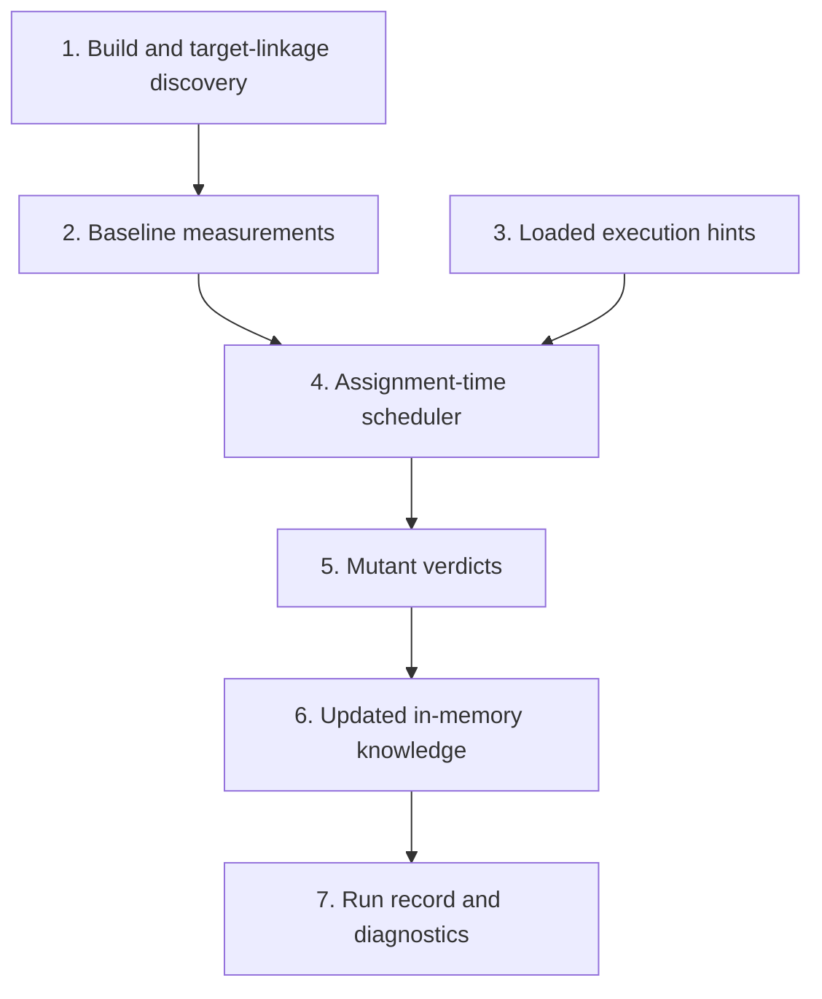

# Scheduling

This document describes how cargo-gamma chooses test work, beginning with
target-linkage discovery before the unmutated baseline. It covers the current
implementation, not a proposed replacement.

## Contents

1. [Target-linkage discovery](#1-target-linkage-discovery)
2. [Baselining](#2-baselining)
3. [Loading hints](#3-loading-hints)
4. [Scheduling mutant work](#4-scheduling-mutant-work)
5. [Testing one mutant](#5-testing-one-mutant)
6. [Learning during the sweep](#6-learning-during-the-sweep)
7. [Persistence and reporting](#7-persistence-and-reporting)

## Shared test resources

Tests may declare a named shared resource with
`#[gamma::resource("name")]`. A function annotation applies to that exact
test and requires a test attribute such as `#[test]` or `#[tokio::test]`; an
inline module annotation applies to every execution of its containing test target.
The source states identity, not machine policy. Capacities come from
the `[resources]` table in `gamma.toml`, may be overridden by repeatable
`--resource-concurrency NAME=N` arguments, and default to one when omitted.
Capacities for resources outside the selected packages remain inactive rather than
invalidating a package-scoped campaign.

Before launching a baseline, mutant, or confirmation process,
cargo-gamma atomically reserves every resource required by that selection and
releases it when the complete process tree has ended. Reservations apply to the
actual test selection rather than the union of a mutant's possible future work.
The process-level reservation remains authoritative. Unrelated tests remain
parallel.

## 1. Target-linkage discovery

**Goal:** avoid building, baselining, or running test binaries that
can be proven unrelated to every pending mutant.

This is a logical scheduling phase within the existing build/preflight work; it
does not currently have its own progress-display label. Its purpose is to
remove test targets proven unable to link any pending mutated source before
paying to baseline or run them.

### 1.1. Coarse package admission

**Goal:** establish the broad set of test binaries policy and Cargo's package
graph permit to judge each mutant.

- The configured test scope first admits packages:
  - package-local testing admits the mutant's own package;
  - `--test-package` admits named oracle packages;
  - `--test-workspace` admits the workspace.
- Cargo dependency analysis then removes admitted package/binary relationships
  that cannot reach the mutated package.
- Unknown package relationships fail open and remain admitted.

This is crate/package-level reachability. It says that a binary may link the
mutated crate, not that it links a particular source file or executes a
particular mutation site.

**Output:** a conservative mapping from each mutant's package to the test
binaries permitted to judge it.

### 1.2. Compiler-captured exact source linkage

**Goal:** refine package-level candidates to test binaries that actually link
each pending mutated source file.

Phase 1.2 cannot replace phase 1.1:

- package admission is policy: a reverse-dependent package may link the source
  but is not allowed to judge it unless `--test-package` or `--test-workspace`
  admits that package;
- exact linkage is optional evidence and can be unavailable or ambiguous, so
  phase 1.1 is the conservative fallback;
- exact linkage only narrows the admitted set; it never introduces a binary
  excluded by package policy.

Conceptually, final candidates are the package-policy candidates intersected
with proven source-linked binaries when exact evidence is available. Without
that evidence, the package-policy candidates remain unchanged.

During the successful Cargo preflight, cargo-gamma installs itself as a
`RUSTC_WRAPPER`. The wrapper:

- forwards every invocation to the configured original wrapper or `rustc`;
- returns that compiler process's representable exit code to Cargo unchanged
  (or failure when it cannot launch the compiler or obtain an exit code);
- records only successful compiler invocations;
- records the crate name and type, `--test` state, primary Rust source,
  output directory, extra filename, and every path-bearing `--extern`;
- marks an invocation opaque when an external dependency cannot be associated
  with a concrete artifact path.

If Cargo configuration declares either `build.rustc-wrapper` or
`build.rustc-workspace-wrapper`, cargo-gamma conservatively stands down from
compiler interposition. A relative configured wrapper is resolved from the
configuration that declared it, and moving that path into the scratch
workspace could invoke a different program. Package-level reachability remains
the safe fallback when exact compiler capture is unavailable.

Cargo's JSON `compiler-artifact` messages independently identify each package,
target kind, target source, executable, and emitted artifact. Cargo-gamma
associates a test artifact with a compiler capture only when:

- the target source matches;
- the capture is a test compilation;
- output directory, crate name, and extra filename identify the artifact; and
- every artifact Cargo reported for that compilation yields the same answer.

Starting at that test compilation, cargo-gamma walks the captured `--extern`
graph:

- registry and Git artifacts terminate traversal because their source is
  outside the workspace;
- workspace artifacts are resolved to exactly one captured compiler
  invocation and traversed recursively;
- each invocation's dep-info file contributes its workspace-relative Rust
  source dependencies;
- the dep-info must include the invocation's primary source.

The result is a set of workspace source files proven to feed each test binary.
Cargo-gamma uses it twice:

- derive exact `--test <name>` Cargo selectors for integration-test targets;
- retain package-level `--tests` selection for library, binary, and example
  unit-test harnesses, which `cargo build` cannot name exactly;
- discard built test binaries whose proven linked-source set contains no
  pending mutated file.

This analysis is an optimization, never exclusion by assumption. Missing or
corrupt captures, ambiguous artifact matches, opaque workspace dependencies,
missing dep-info, inconsistent Cargo artifacts, or unsupported target kinds
abandon exact narrowing. The run retains the coarser package-level result. If
the exact-selector build fails, cargo-gamma retries the build with all test
targets before that failure can affect a mutant.

**Output:**

- each test binary annotated with either a proven set of linked workspace
  source files or `unknown`;
- exact Cargo target selectors when every relevant association is known;
- the retained test-binary set, after removing only binaries proven unrelated
  to every pending mutant.

## 2. Baselining

**Goal:** prove that the unmutated test oracle is green and measure the
execution characteristics later mutant runs must be compared against.

Cargo-gamma runs every retained test binary without an active mutant.

**Output:** for each test binary:

- package, target, executable, and the linked-source result established above;
- whole-binary duration;
- number of tests, when the harness reported it;
- timeout, stall, and memory calibration;
- the binary's candidate mutated source files: proven linked files when exact
  capture succeeded, or conservative package-level candidates when linkage is
  unknown. Neither case proves that a test executes a particular mutation
  site; ordinary active-mutant launches observe that separately.

## 3. Loading hints

**Goal:** start with previously learned test ordering instead of rediscovering
every likely killer and useful binary from scratch.

When incremental behavior is enabled, cargo-gamma merges:

- `gamma-hints.yaml`, the checked-in hints artifact; and
- `last-gamma-run.json`, the local run record, which wins on conflicts.

A mutant ID is the content-derived identifier of one specific generated
replacement. It is derived from the workspace-relative source file, enclosing
item, mutator, normalized original site text, occurrence, and replacement
index. It is independent of the run-local ordinal and source line number, so
unrelated edits elsewhere in a file do not invalidate it.

Hints can contain:

- an exact previously killing `{ package, kind-qualified target, test }` for a mutant ID;
- ranked exact tests for a stable `(source file, enclosing item)`;
- ranked test binaries for a source file;
- test sets known to reach a stable source site;
- likely compiler-unviable mutants, used only for build ordering.

Hints are guesses, not verdicts. A test or binary named by a hint is run again
before it can affect the result. Missing, stale, corrupt, or unsupported hints
fall back to colder scheduling.

The version-4 YAML artifact groups exact mutant hints by workspace-relative source
file. Each file group contains a deterministic table of distinct killer
identities, and its mutant entries refer to those identities by index. The
source path and repeated package, target, and test strings therefore occur
once per shared group instead of once per mutant. Generalized item, file, and
reach hints retain their independently versioned representation and interned
reach-test sets.

Its `context` contains the repository HEAD SHA and UTC generation date only.
Those fields explain where the artifact generation came from; they do not gate
score-neutral hints or attribute incrementally retained knowledge to that
commit. Malformed artifacts, foreign producers, and unsupported versions are
ignored rather than partially trusted.

**Output:**

- mutant ID to exact candidate killer;
- `(source file, item)` to ranked candidate tests;
- source file to ranked candidate binaries;
- stable source site to previously observed reaching tests;
- likely-unviable mutant IDs for build ordering only.

## 4. Scheduling mutant work

**Goal:** overlap independent work, expose useful learning before related work
starts, and avoid leaving expensive work as a long serial tail.

Cargo-gamma estimates each pending mutant's serial test cost:

- exact killer hint: a short filtered probe plus a small miss-weighted
  whole-suite fallback;
- whole-binary fallback: half the whole-binary baseline for the initial
  killed-mutant prior;

Saved selection hints seed inferred candidates' scheduling probability and probe
cost from the hint artifact's hit, miss, measured-time, and sample counters.
Speculative inferred-test probes are bounded candidates, not an exhaustive isolation
search: a miss or inconclusive probe falls back to the authoritative admitted
selection instead of enumerating every possible test subset.

The cost order is still partitioned into package queues and interleaved. That
order supplies deterministic package-fair, longest-work-first secondary
priority, but workers no longer claim it through a fixed cursor. A worker asks
the scheduler for an assignment only when it is ready to run one.

Each package keeps an ordered queue of its currently eligible candidates, and
the global frontier contains only the best candidate from each package.
Selection reads the first global entry instead of rescanning all mutants.
Claims and completions rekey only candidates in the affected source file;
package-turn fairness updates only that package's global entry. Claimed work is
removed permanently within each pass, and a separate remaining count identifies
an exhausted pass. After the global exact-hint pass, completed mutants leave the
frontier and sibling benefits and full-binary discovery costs are recomputed
for the unresolved population.

The scheduler preserves package-turn fairness first. Within a package, a
function with a fresh named killer takes priority while that candidate's
seed-plus-transfer-hit count is at least its transfer-miss count. Freshness
requires a named kill in this campaign, not merely a persisted hint. Repeated
misses remove this exploitation boost without retiring the candidate.

The next priority is discovery distance:

1. an item in a file with no active mutant;
2. an inactive item in an active file, preferring the least-contended file;
3. another mutant in an already-active item.

Within the same distance tier the scheduler prefers
greater learning leverage per estimated evaluation cost, retains longest-work-first
value, and finally uses the stable pre-sweep order. Learning leverage is the
number of pending siblings that can reuse the completed mutant's observations.

Same-item mutants may execute concurrently; there is no scout gate that leaves
workers idle while siblings remain queued. Every phase uses the configured job
count, even when it exceeds available CPU parallelism. There is no aggregate
memory reservation or scheduler-imposed memory envelope. Users reduce the job
count when concurrent execution exhausts system memory; per-process memory
limits and named-resource capacities remain enforced.

**Output:** immutable scheduling-cost metadata and a synchronized
assignment-time scheduler tracking remaining work and active file and item
reservations.

## 5. Testing one mutant

**Goal:** reach the first trustworthy verdict with the least test work.

Remaining fallback binaries are ordered at entry to fallback:

1. binaries from the mutant's own package;
2. binaries from other selected test packages;
3. most distinct mutants killed to date first within each tier;
4. shorter baseline duration when kill counts tie;
5. stable package, target, and path tie-breakers.

Counts are seeded from known exact-killer hints, including historical mutants,
and updated by observed kills from any execution stage. Rechecking a known
mutant does not count it twice; a different killer moves that mutant's credit
to the new binary. Unnamed kills also count. Passing, flaky, and
resource-failing probes do not add kills. Each mutant snapshots the latest
counts when entering fallback; concurrent discoveries affect later snapshots.
Baseline-sorted reachable order remains the reference for final non-killing
outcome precedence, independently of execution order.

The campaign drains exact hints across the population first. Each worker then
takes an unresolved mutant through the remaining stages to a final verdict:

1. Exact checked-in or local killing-test hints.
2. Ranked same-item exact tests, followed by persisted exact-site reach candidates.
   Both libtest and nextest retain the first six eligible distinct cases and
   execute them individually in priority order, without grouping by binary.
3. Every distinct inferred full binary, best-first, including binaries identified
   by named cases, item/file reach observations, and file-local kills.
4. Remaining reachable full binaries in kill-count order, reusing all full-binary
   results from phase 3.

Only the exact-hint pass is a global barrier. Each later stage reads the current
learning state. A named killer discovered by full-binary execution is published
before the worker claims another mutant, so queued siblings can immediately
benefit from named inference.

A kill settles immediately, regardless of its binary's position.
Loss of containment aborts the campaign immediately. Without a kill, the first
non-passing full-binary result in stable reachable order determines the outcome.
Only passing named probes suppress duplicate cases; inconclusive named probes
remain eligible. Passing selected cases never proves survival. Each mutant runs
one selection at a time, including under nextest; parallelism is across mutants.
Unreachable, filtered, duplicate, and already-passing cases do not consume the
six-case allowance. Full-binary inference retains all candidates regardless of
the named-case cap.

Inferred-test evidence distinguishes the exact kill or reach observation that
seeded a candidate from transfer evidence gathered against other mutants. A
candidate's transfer history ranks it without an economic admission filter,
two-miss retirement, or a campaign-wide cold-start circuit breaker.

A candidate failure is a transfer hit and a clean pass is a transfer miss.
Timeouts, stalls, memory exhaustion, flakes, enumeration failures, metering
loss, and unjudged launches are inconclusive and do not alter that candidate's
hit or miss counters. Canonical execution also supplies soft negative evidence
for binaries that are already item or file candidates: two clean canonical
passes have the ranking weight of one explicit transfer miss. Soft evidence
may demote a candidate, but it never creates one and
cannot exclude canonical work or determine a verdict.

**Output:** one mutant outcome, elapsed time, optional killing test, and
optional diagnostic note.

## 6. Learning during the sweep

**Goal:** let completed mutant work improve the ordering of related mutants
that have not yet committed to their test work.

Workers prefer independent files and items, but do not withhold same-item
siblings while waiting for learning. All exact hinted kills are published before
the inferred named-test phase starts.

A completed mutant publishes:

- its exact killing test for later mutants in the same item;
- its killing or reaching binary for later mutants in the same file;
- lower-weight negative ranking evidence when a known candidate binary passes
  cleanly during canonical execution;
- safe negative reach evidence for another replacement at the exact same
  stable source site.

Ordinary active-mutant launches report reach through `GAMMA_REACH`; no
pre-run reach sampling is performed. Only a complete, sealed, passing
whole-binary observation can establish that its binary did not reach the
active site. That absence transfers only to another replacement at the same
stable site while deterministic reach narrowing is enabled. Filtered,
failed, incomplete, and nondeterministic observations never establish absence.
`--whole-test-binaries` suppresses case-level probes and deterministic reach
narrowing.

The worker publishes all exact-test, reaching-binary, file-binary, soft
canonical-negative, and safe negative-reach learning before releasing its
file/item reservation, so a related follow-on assignment observes the completed
learning.

**Output:** updated in-memory exact killers, ranked item/file
candidates with separate seed and transfer evidence, and safe exact-site reach
exclusions for work that has not started yet.

## 7. Persistence and reporting

**Goal:** preserve score-neutral scheduling knowledge for later campaigns and
report whether hints and learned reach evidence reduced execution cost.

After the sweep:

- exact mutant killers and generalized item/file/reach knowledge are stored in
  the local run record;
- `cargo gamma hints` incrementally promotes applicable knowledge into
  `gamma-hints.yaml`, preserving entries outside its selection; `--replace`
  deliberately rebuilds it from the selected population;
- build-round diagnostics attribute each round's withdrawals to packages. The
  elapsed time remains the measured workspace-wide Cargo invocation and is not
  divided into fictitious package durations;
- selection diagnostics count whole-binary and uncovered decisions;
- hint funnels report candidates, attempts, and hits for exact mutant hints and
  inferred item, reach, and file tiers;
- `gamma-selection.jsonl` receives each mutant's completed attempts as one worker-side batch, then
  records and immediately flushes every retained selection attempt with its mutant ordinal,
  candidate tier and rank, binary and optional test identity, hit/miss/inconclusive result, elapsed
  time, and canonical fallback estimate. Serialization reuses one buffer and issues one write per
  complete record. The journal retains at most 64 MiB per campaign and appends a truncation record
  when the ceiling is reached, so diagnostic growth cannot stop mutant execution; the retained
  prefix of complete records can still be replayed without treating telemetry as verdict evidence;
- package sweep timelines report first start, final completion, and wall span
  relative to sweep start. These spans can overlap under concurrency and are
  distinct from the package CPU totals; and
- diagnostics retain total launches and launches saved, including the subset
  saved by learned reach evidence. The live dashboard's estimated hint savings subtract every
  attempted selection in the successful mutant's chain from the canonical fallback estimate, not
  only the final successful launch.

Promotion writes version 4 YAML atomically. File groups, mutant entries, killer
tables, generalized identities, and interned reach sets use canonical ordering,
so equivalent knowledge produces identical reviewable bytes regardless of
discovery or completion order. A no-op preserves `generated_on` and produces no
file change. A changed generation records the current HEAD SHA and UTC date.
Incremental promotion refuses a malformed, foreign, or unsupported existing
artifact rather than treating it as empty; `--replace` is the explicit
permission to discard such a generation. This includes unsupported
independently versioned generalized data, which today's serializer cannot
round-trip without losing future fields. Publication compares against the exact
YAML bytes used by the merge, so a concurrent update
is left intact and reported as a conflict.

The generalized section uses schema version 3, separating seed observations
from transfer hits and misses and storing kind-qualified target identities. Versions 1 and 2 are
migrated on read; other generalized schemas are unsupported.

Persisted knowledge changes ordering and selection only. It never carries a
verdict into a new campaign without executing the relevant test again.

**Output:** `last-gamma-run.json`, promoted `gamma-hints.yaml` when requested,
final reports, and diagnostics containing hint and sweep effectiveness
metrics.
