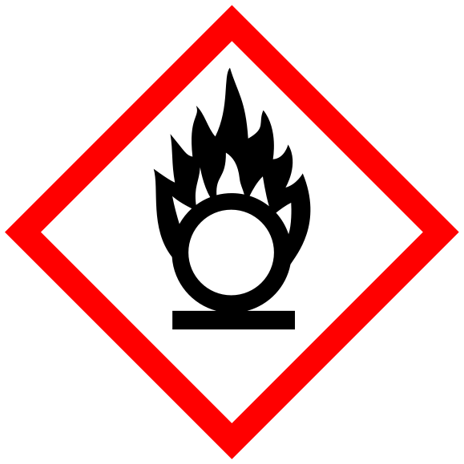

<div align="center">
 

# Cargo-Spellcheck-Helper

[](https://crates.io/crates/cargo-spellcheck-helper)
[](https://docs.rs/cargo-spellcheck-helper)
[](https://crates.io/crates/cargo-spellcheck-helper)
[](https://github.com/microsoft/ox-tools/actions/workflows/anvil-scheduled.yml)
[](https://codecov.io/gh/microsoft/ox-tools)
[](../../LICENSE)
<a href="../.."></a>

</div>

Portable setup helpers for cargo-spellcheck.

Prepare a repository word list in Hunspell’s dictionary format and check
the native prerequisites needed to build cargo-spellcheck from source,
without PowerShell. The helper does not run the spellchecker or install
system packages, and does not itself require libclang.

## Installation

```text
cargo install cargo-spellcheck-helper
```

## Usage

```text
cargo spellcheck-helper prepare-dictionary --input .spelling --output target/spelling.dic
cargo spellcheck-helper check-source-deps
```

Direct invocation as `cargo-spellcheck-helper` also works.

Dictionary preparation uses `hunspell-dictgen`: missing input produces an
empty dictionary, empty and ASCII-decimal-only lines are removed, entries
are sorted with duplicates retained, and UTF-8/LF output is published
atomically.

The prerequisite check models native default-feature cargo-spellcheck
0.15.7 installation. It follows clang-sys’s link-time libclang discovery:
an authoritative file or directory in `LIBCLANG_PATH`, LLVM/Xcode discovery,
`LD_LIBRARY_PATH`, and platform search patterns. ELF/PE architecture,
Windows MSVC import libraries and DLL `PATH`, and dynamic loadability are
checked. C/C++ compiler and archiver availability use `cc` discovery.
Missing prerequisites produce installation guidance; the actual dependency
build remains authoritative for headers, SDKs, and final linking.

Success exits with code 0 and produces no stdout. Operational failures
exit with code 1 and a diagnostic on stderr; argument errors exit with
code 2.


<hr/>
<sub>
This crate was developed as part of <a href="../..">The Oxidizer Project</a>. Browse this crate's <a href="https://github.com/microsoft/ox-tools/tree/main/crates/cargo-spellcheck-helper">source code</a>.
</sub>

